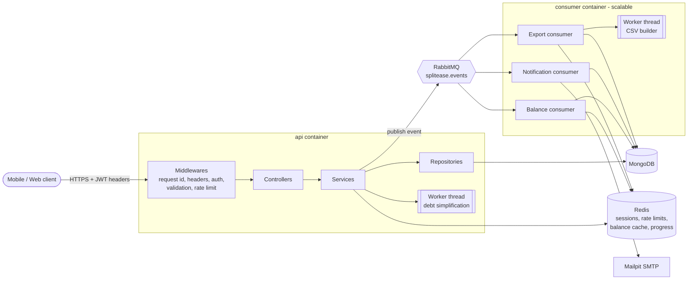

# SplitEase API

A Splitwise-style REST API for sharing expenses within groups: add expenses (equal, exact or percent
splits), see who owes whom, settle up, get an activity feed and export a group's history as CSV.

Built with **Express 5 + TypeScript (strict, no `any`)**, **MongoDB**, **Redis**, **RabbitMQ** and
**Node worker threads**, and fully runnable with `docker compose`.

---

## Table of contents

- [Quick start](#quick-start)
- [Architecture](#architecture)
- [Folder structure](#folder-structure)
- [API conventions](#api-conventions)
- [API reference](#api-reference)
- [Background processing](#background-processing)
- [Design decisions and edge cases](#design-decisions-and-edge-cases)
- [Testing](#testing)
- [Configuration](#configuration)

---

## Quick start

Requirements: Docker with Compose v2. Node 20+ is only needed to run the tests or the API outside Docker.

```bash
cp .env.example .env              # optional: compose has working defaults
docker compose up --build -d      # api, consumer, mongo, redis, rabbitmq, mailpit
curl http://localhost:3000/health
```

| URL                          | What                                          |
| ---------------------------- | --------------------------------------------- |
| http://localhost:3000/docs   | Swagger UI (OpenAPI 3 at `/docs.json`)        |
| http://localhost:3000/health | Health of Mongo, Redis and RabbitMQ           |
| http://localhost:15672       | RabbitMQ management (`guest` / `guest`)       |
| http://localhost:8025        | Mailpit: every email the app sends lands here |

**Port already in use?** Every host port can be overridden without editing files, for example when
another Redis is already bound to 6379:

```bash
REDIS_HOST_PORT=6380 docker compose up --build -d
```

Available overrides: `API_PORT`, `MONGO_HOST_PORT`, `REDIS_HOST_PORT`, `RABBITMQ_HOST_PORT`,
`RABBITMQ_UI_PORT`, `SMTP_HOST_PORT`, `MAILPIT_UI_PORT`. Containers always talk to each other on the
internal network, so the overrides only change what is exposed on your machine.

**Scale the consumers** (messages are shared across instances and processed exactly once):

```bash
docker compose up -d --scale consumer=3
```

### Running locally without Docker for the app

```bash
npm ci
docker compose up -d mongo redis rabbitmq mailpit
cp .env.example .env
npm run dev            # API with reload
npm run dev:consumer   # background consumers, in a second terminal
```

### Postman

Import `postman/SplitEase.postman_collection.json`. It is generated from the same OpenAPI document as
Swagger (`npm run postman:generate`), so they never drift apart.

- Device headers, credentials and ids are collection variables.
- Test scripts save `x-access-token` / `x-refresh-token` from the response headers and remember the
  created `groupId`, `expenseId`, `exportId` and the member found by `GET /users/search`.
- The collection runs top to bottom (35 requests, all assertions pass). Register a second user first
  and set `memberEmail` to that user's email:

```bash
npx newman run postman/SplitEase.postman_collection.json \
  --env-var email=aman1@example.com --env-var memberEmail=rahul1@example.com
```

---

## Architecture



**Request flow.** `routes → middlewares → controller → service → repository`.

- **Routes** only wire middlewares to controller methods.
- **Controllers** read the validated input, call one service method and send the envelope. They
  contain no business logic.
- **Services** hold all business rules, talk to Redis, publish events and run worker tasks.
- **Repositories** are the only place that touches Mongoose models. Every read is `lean()`; lists use
  `$facet`; balances are computed with aggregation pipelines.
- Every class is exported as a singleton and receives its dependencies through the constructor, so it
  can be tested with fakes.

**Two processes, one image.** `api` (`dist/main.js`) serves HTTP. `consumer` (`dist/consumer.js`) runs
the RabbitMQ consumers. Both are built from the same multi-stage `Dockerfile`, run as the non-root
`node` user, and shut down gracefully on `SIGTERM`. The API stops accepting connections, finishes
in-flight requests, then closes Mongo, Redis and RabbitMQ. Consumers cancel their subscriptions, wait
for in-flight messages, then exit.

---

## Folder structure

```
src/
├── main.ts                     HTTP server bootstrap + graceful shutdown
├── consumer.ts                 Consumer process bootstrap + graceful shutdown
├── app.ts                      Express app: cors, helmet, swagger, health, routes, errors
├── app.routes.ts               Mounts every module router under /api/v1
├── config/                     configuration.ts (validated env), swagger.ts (OpenAPI document)
├── common/                     constant, errors (AppError), responses (ApiResponse), messages (localized), utils
├── enum/                       SplitType, DeviceType, ExportStatus, ActivityType, EventType, Lang
├── interfaces/                 Request augmentation, events, pagination, auth types
├── logger/                     winston logger with request id context and secret redaction
├── middlewares/                header validator, access/refresh token, group member, validate,
│                               rate limit, request context, error + not found
├── schemas/                    Mongoose schemas with indexes (7 collections)
├── repositories/               Data access only (BaseRepository + one per collection)
├── providers/
│   ├── database/               Mongo connection with retry
│   ├── redis/                  ioredis client + Lua scripts, RedisService
│   ├── rabbitmq/               connection, topology (exchanges/queues/DLQs), confirm publisher
│   ├── consumers/              BaseConsumer (retry, DLQ, idempotency) + balance/notification/export
│   ├── workerThread/           WorkerThreadService (pool) + simplifyDebts / exportCsv workers
│   └── email/                  nodemailer provider + templates
└── modules/v1/<module>/        auth, user, group, expense, balance, settlement, activity, export
    ├── <module>.routes.ts
    ├── <module>.controller.ts
    ├── <module>.service.ts
    ├── dto/<module>.dto.ts     zod schemas for body / params / query
    └── interface/              module types
tests/unit/                     vitest: split maths, balances, debt simplification, CSV, time, pool
scripts/                        generate-postman.ts, smoke.ts (end-to-end check of a running stack)
postman/                        generated Postman collection
```

---

## API conventions

### Required headers

Every `/api/v1/*` route (not `/health`, not `/docs`) needs:

| Header        | Rule                                  | Error when missing / invalid                   |
| ------------- | ------------------------------------- | ---------------------------------------------- |
| `device_id`   | 1-128 chars, letters/digits/`-_.:`    | `DEVICE_ID_REQUIRED` / `INVALID_DEVICE_ID`     |
| `device_type` | `1` Android, `2` iOS, `3` Web         | `DEVICE_TYPE_REQUIRED` / `INVALID_DEVICE_TYPE` |
| `timezone`    | IANA name, e.g. `Asia/Kolkata`        | `TIMEZONE_REQUIRED` / `INVALID_TIMEZONE`       |
| `lang`        | `en` (localized messages; more locales later) | `LANG_REQUIRED` / `INVALID_LANG`         |

> These header names contain underscores. Express reads them fine, but if you put nginx in front of
> the API you need `underscores_in_headers on;`.

`timezone` is used wherever a date is interpreted or shown: `expenseDate: "2026-10-28"` means that day
in the caller's timezone, `from` / `to` filters cover whole local days, and the CSV export prints dates
in the requester's timezone.

### Authentication

- `register`, `login` and `refresh` return tokens **only** in the `x-access-token` and
  `x-refresh-token` response headers, never in the body. CORS exposes both headers, and the responses
  carry `Cache-Control: no-store`.
- Protected routes take `Authorization: Bearer <access token>` (15 minutes, payload `{ sub, sid }`).
- `POST /auth/refresh` takes the refresh token in the `x-refresh-token` request header (7 days, payload
  `{ sub, sid, jti }`).
- **Sessions are per device.** Logging in again with the same `device_id` replaces that device's
  session. A token used with a different `device_id` header is rejected.
- **Rotation with reuse detection.** Redis stores only the current `jti` of each session. A Lua script
  swaps it atomically on refresh. Presenting an old refresh token means it was copied, so the whole
  session is revoked and the call returns `401 REFRESH_TOKEN_REUSED`.
- Logout ends this device's session; logout-all ends every session. Access tokens stop working
  immediately because each request checks that the session still exists in Redis.

### Response envelope

The assignment's **Response envelope** section defines two shapes, and both are produced in one place:
`ApiResponse` in `src/common/responses.ts` for success, and the global error middleware for every
failure.

```jsonc
// success
{ "statusCode": 201, "message": "Expense added", "data": { "expense": { /* ... */ } } }

// error
{ "statusCode": 400, "code": "SPLIT_TOTAL_MISMATCH",
  "message": "Splits must add up to the expense amount",
  "requestId": "5c1e2f0a-6d7e-4f1b-9a3c-2b1d0e9f8a7c",
  "details": [{ "field": "splits", "message": "..." }] }      // details only for validation errors
```

Services throw `AppError(code)`. The error middleware maps the code to its HTTP status, localizes the
message using `lang`, and adds the `requestId`, which is also sent back in the `x-request-id` header and
included in every log line. Malformed JSON, oversized bodies, Mongo cast/validation errors and
duplicate keys are all turned into the same envelope. Unknown errors become `500 INTERNAL_ERROR` without
leaking internals.

| Status | Codes                                                              |
| ------ | ------------------------------------------------------------------ |
| 400    | `VALIDATION_ERROR`, header codes above, `SPLIT_TOTAL_MISMATCH`     |
| 401    | `UNAUTHORIZED`, `TOKEN_EXPIRED`, `REFRESH_TOKEN_REUSED`            |
| 403    | `NOT_GROUP_MEMBER`                                                 |
| 404    | `NOT_FOUND`                                                        |
| 409    | `EMAIL_TAKEN`, `ALREADY_MEMBER`, `BALANCE_NOT_SETTLED`, `CONFLICT` |
| 413    | `PAYLOAD_TOO_LARGE`                                                |
| 429    | `TOO_MANY_ATTEMPTS` (with `Retry-After`)                           |
| 500    | `INTERNAL_ERROR`                                                   |
| 503    | `SERVICE_UNAVAILABLE`                                              |

### Money, lists and dates

- Money is always an **integer number of paise** (₹12.50 = `1250`), currency INR, with a maximum of
  ₹10 crore per expense so that every intermediate sum stays an exact integer.
- An **equal split** gives everyone `floor(amount / n)`, and the leftover paise go one each to the first
  members in the given order (₹100 between 3 people is `3334, 3333, 3333`).
- A **percent split** accepts up to 2 decimals that must add up to exactly 100. Shares use the
  largest-remainder method, so they always add up to the amount.
- An **exact split** must add up to the amount, otherwise the response is `400 SPLIT_TOTAL_MISMATCH`.
- **Balances**: positive `net` means the member is owed money; negative means they owe.
- **Lists** accept `page` (default 1), `limit` (default 20, max 100), `sortBy` (whitelisted per list)
  and `order` (`asc` | `desc`), and return `{ items, page, limit, total, totalPages }`.

---

## API reference

Full request and response schemas with examples are in Swagger at `/docs`. All paths below are under
`/api/v1` except `/health`.

| #   | Method | Path                                   | Auth    | Description                                             |
| --- | ------ | -------------------------------------- | ------- | ------------------------------------------------------- |
| 1   | POST   | `/auth/register`                       | –       | Create an account, returns tokens in headers            |
| 2   | POST   | `/auth/login`                          | –       | Log in (rate limited)                                   |
| 3   | POST   | `/auth/refresh`                        | refresh | Rotate the token pair                                   |
| 4   | POST   | `/auth/logout`                         | bearer  | End this device's session                               |
| 5   | POST   | `/auth/logout-all`                     | bearer  | End all sessions                                        |
| 6   | GET    | `/auth/sessions`                       | bearer  | Active devices (`current` marks this one)               |
| 7   | GET    | `/users/me`                            | bearer  | My profile                                              |
| 8   | PATCH  | `/users/me`                            | bearer  | Update my name                                          |
| 9   | GET    | `/users/search?email=`                 | bearer  | Find a user by exact email                              |
| 10  | POST   | `/groups`                              | bearer  | Create a group (creator is a member)                    |
| 11  | GET    | `/groups`                              | bearer  | My groups with `myBalance` in each                      |
| 12  | GET    | `/groups/:groupId`                     | member  | Group details and members                               |
| 13  | PATCH  | `/groups/:groupId`                     | member  | Rename                                                  |
| 14  | POST   | `/groups/:groupId/members`             | member  | Add a member by email                                   |
| 15  | DELETE | `/groups/:groupId/members/:userId`     | member  | Remove a member (balance must be 0)                     |
| 16  | POST   | `/groups/:groupId/expenses`            | member  | Add an expense (EQUAL / EXACT / PERCENT)                |
| 17  | GET    | `/groups/:groupId/expenses`            | member  | List: `search`, `paidBy`, `from`, `to`, sort, page      |
| 18  | GET    | `/groups/:groupId/expenses/:expenseId` | member  | One expense with splits                                 |
| 19  | PATCH  | `/groups/:groupId/expenses/:expenseId` | member  | Edit (splits re-validated)                              |
| 20  | DELETE | `/groups/:groupId/expenses/:expenseId` | member  | Soft delete                                             |
| 21  | GET    | `/groups/:groupId/balances`            | member  | Net balance per member                                  |
| 22  | GET    | `/groups/:groupId/settle-plan`         | member  | Fewest payments to settle (worker thread)               |
| 23  | GET    | `/balances/me`                         | bearer  | Totals across all my groups                             |
| 24  | POST   | `/groups/:groupId/settlements`         | member  | Record a payment                                        |
| 25  | GET    | `/groups/:groupId/settlements`         | member  | Settlement history                                      |
| 26  | GET    | `/activity`                            | bearer  | My activity feed (`groupId` filter)                     |
| 27  | POST   | `/groups/:groupId/exports`             | member  | Request a CSV export → `202`                            |
| 28  | GET    | `/exports/:exportId`                   | member  | Status and `progress` (0-100)                           |
| 29  | GET    | `/exports/:exportId/download`          | member  | Download the CSV (`404` until `DONE`)                   |
| –   | GET    | `/health`                              | –       | `200` when Mongo, Redis and RabbitMQ are up, else `503` |

`member` means a bearer token **and** membership of the group. Non-members get `403 NOT_GROUP_MEMBER`,
and a group that does not exist gives `404`.

---

## Background processing

Every write to the ledger (expense created/updated/deleted, settlement created) and every new member
publishes an event to the `splitease.events` topic exchange with publisher confirms. Each queue has a
`.retry` queue (message TTL, then back to the main queue) and a `.dlq`:

| Queue                    | Events                                       | Work                                                                   |
| ------------------------ | -------------------------------------------- | ---------------------------------------------------------------------- |
| `splitease.balance`      | expense.\*, settlement.created               | Recompute the group's balances and cache them in Redis                 |
| `splitease.notification` | expense.\*, settlement.created, member.added | Write the activity entry and email the people involved (not the actor) |
| `splitease.export`       | export.requested                             | Build the CSV in a worker thread, report progress in Redis             |

**Reliability.** Messages are acknowledged manually.

- A failure goes to the retry queue, up to `CONSUMER_MAX_RETRIES` (default 3, every 5 s); after that
  the message goes to the DLQ. A malformed message goes straight to the DLQ.
- Consumers are idempotent. A Redis "done" marker per (queue, eventId), plus a short lock, means
  redeliveries and parallel consumers never process an event twice. Activity entries have a unique
  `eventId`, and each recipient's email has its own marker, so a retry after a partial failure only
  sends the emails that are still missing.
- A lost connection reconnects with backoff and re-subscribes.

**Balances stay correct even when the queue is behind.**

- Each ledger write increments `balances:version:<groupId>` in Redis. The consumer stores a snapshot
  together with the version it was computed from, and a Lua script only replaces a cached snapshot with
  a newer one.
- `GET /balances` returns the cached snapshot and `stale: true` while a newer write is still queued. If
  the snapshot is older than `BALANCE_STALE_RECOMPUTE_SECONDS`, or missing, the API recomputes it with
  the aggregation pipeline instead of waiting.
- If publishing an event fails, the cache is invalidated so the next read recomputes.
- Removing a member always checks a freshly computed balance, never the cache.

**Worker threads.** Debt simplification for `settle-plan` and CSV generation run in a small worker pool
(`WORKER_POOL_SIZE`), with a timeout per task and progress messages. Heavy computation never blocks the
event loop.

---

## Design decisions and edge cases

- **Equal splits**: participants default to all members, must be unique members of the group, and the
  payer must be a member too. A zero amount is rejected.
- **Edits** accept any subset of fields. Changing only `amount` re-splits EQUAL and PERCENT expenses
  automatically. An EXACT expense needs new `splits` (otherwise `SPLIT_TOTAL_MISMATCH`). Deleted
  expenses cannot be edited and do not show up in lists, balances or exports.
- **Settlements**: `fromUserId` defaults to the caller. Both users must be members, and paying yourself
  is rejected.
- **Members**: the maximum is 50 per group; adding an existing member returns `409 ALREADY_MEMBER`.
  Anyone, including yourself, can only be removed with a zero balance. When the last member leaves,
  the group is archived.
- **Exports**:
  - If an export of the same group by the same user is already queued or running, that one is returned
    instead of starting another.
  - If the event cannot be published, the export is marked failed and the call returns `503`.
  - Files are written to a temporary path and renamed when complete.
  - Cells starting with `= + - @` are escaped against CSV formula injection, and the file starts with a
    BOM so Excel reads the ₹ sign.
- **Search**: expense search uses a MongoDB text index scoped by `groupId`.
- **Rate limits** (Redis fixed window, fail-open if Redis is down):
  - login: 5 per minute per email + IP
  - register: 20 per 10 minutes per IP
  - user search: 30 per minute per user
- **Timing attacks**: login with an unknown email still runs a bcrypt compare, so response times do not
  reveal which emails are registered.
- **Logs**: JSON logs carry the `requestId`. Passwords, tokens and anything that looks like a JWT are
  redacted.
- **Hardening**: helmet, a JSON body limit of 100 kb, `trust proxy` is configurable, and the
  configuration is validated at startup (the process exits with a clear message when an env var is
  wrong).

---

## Testing

```bash
npm test             # unit tests (vitest): split maths, balances, debt simplification, CSV, timezones, worker pool
npm run typecheck    # tsc over src, tests and scripts
npm run lint         # eslint (typescript-eslint strict, no any)
npm run format:check # prettier
npm run smoke        # end-to-end: 85 checks against a running stack (docker compose up first)
```

`npm run smoke` goes through every endpoint and the important failure cases. It covers header errors,
refresh token reuse, split rounding, `SPLIT_TOTAL_MISMATCH`, non-member access, stale balances
converging, the activity feed, emails arriving in Mailpit, and export progress and download. Set
`BASE_URL` and `MAILPIT_URL` if you changed the ports.

---

## Configuration

Every variable is listed with a default in [`.env.example`](.env.example). The ones you are most likely
to change:

| Variable                                   | Default    | Meaning                                          |
| ------------------------------------------ | ---------- | ------------------------------------------------ |
| `JWT_ACCESS_SECRET` / `JWT_REFRESH_SECRET` | dev values | **Change in production** (min 32 chars)          |
| `ACCESS_TOKEN_TTL_SECONDS`                 | `900`      | Access token lifetime                            |
| `REFRESH_TOKEN_TTL_SECONDS`                | `604800`   | Refresh token / session lifetime                 |
| `CORS_ORIGINS`                             | `*`        | Comma-separated list of allowed origins          |
| `BALANCE_STALE_RECOMPUTE_SECONDS`          | `60`       | After this, a stale balance is recomputed inline |
| `CONSUMER_MAX_RETRIES`                     | `3`        | Retries before a message is dead-lettered        |
| `WORKER_POOL_SIZE`                         | `2`        | Worker threads per task type                     |
| `SWAGGER_ENABLED`                          | `true`     | Serve `/docs`                                    |
